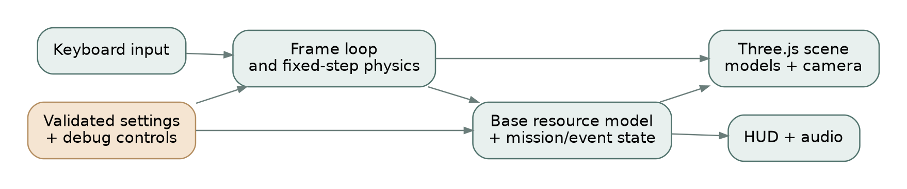

# Nebula: Technical Design and Implementation

**Technical contribution to the final project report**  
Prepared: 14 November 2026  
Reviewed gameplay revision: `1371d3b74c1560610cd415c3741d67f7e20955ef`  
Project: https://github.com/YoussefHossam328/Nebula  
Playable prototype: https://youssefhossam328.github.io/Nebula/

## 1. Project overview and scope

Nebula is a browser-based educational Mars outpost game developed for NASA Space Apps’ Junior Astronaut Mission Trainer challenge [1]. It combines a three-dimensional environment, an angled perspective camera, keyboard-controlled exploration and a resource simulation. The intended audience is children aged 7–12, with scope for family or classroom support and the team’s wider 7–14 audience.

The current prototype includes a title menu, separate practical tutorials, a configurable seven-sol survival challenge, oxygen production, solar generation, battery storage, powered crops, nourishment, radiation exposure, shelter and delayed communications. Local dust, cold and particle-event scenarios create changing operating conditions. The objective is to maintain the outpost while observing the consequences of limited power and supplies.

The game is an educational approximation. NASA observations anchor selected environmental quantities, while equipment specifications, accelerated growth and survival thresholds are explicitly identified as gameplay assumptions. It is not a flight simulator, a medical model or a NASA-validated mission-planning tool.

## 2. Technology stack

| Component | Technology | Role |
| --- | --- | --- |
| Application | TypeScript 7.0.2, HTML and CSS | Typed simulation logic, user interface and browser integration. |
| Rendering | Three.js 0.187.0 | WebGL rendering, lighting, model loading, animation and camera control. |
| Physics | Rapier compatibility package 0.21.0 | WebAssembly-backed character collision, static colliders and movement queries. |
| Development/build | Vite 8.3.8; Node.js 24 in CI | Development server, asset processing and production build. |
| Developer controls | lil-gui 0.21.0 | Categorized settings, balance controls and event activation. |
| Unit/integration checks | Vitest 5.1.0 | Settings, numerical models and real Rapier controller tests. |
| Browser checks | Playwright 1.65.0 with Chromium | Player journeys, equipment interaction and rendering checks. |
| Delivery | GitHub Actions and GitHub Pages | Automated verification and static hosting. |

Versions above describe the reviewed installation. Dependency ranges are declared in `package.json`; `package-lock.json` records the resolved dependency graph, and CI installs it with `npm ci`.

## 3. Runtime architecture

The application runs on the client. No application backend, account system or remote database is required. Vite builds static HTML, JavaScript, CSS, JSON and model assets into `dist/`, which GitHub Pages serves beneath `/Nebula/`.



**Figure 1.** Input drives the character controller and mission actions. Simulation state feeds the world, HUD and audio; the camera follows the interpolated character position. Configuration and the debug panel expose controlled changes to these systems.

| Source module | Main responsibility |
| --- | --- |
| `src/main.ts` | Initializes graphics and physics; coordinates the frame loop and application systems. |
| `src/input.ts`, `src/physics.ts` | Keyboard state, character movement, jumping, crouching and collision. |
| `src/camera.ts`, `src/turning.ts` | Delayed camera following, smoothing, shake and visible character rotation. |
| `src/base/model.ts`, `src/base/config.ts` | Resource accounting, sunlight, radiation, shelter, maintenance and scenario settings. |
| `src/mission.ts`, `src/events.ts` | Menu/tutorial/mission flow, local event calendar, crops, HUD and results. |
| `src/authored-station.ts`, `src/layout.ts` | Supplied base preparation, room decoration, collision and shared equipment anchors. |
| `src/assets.ts`, `src/base/solar-model.ts` | Player and solar GLB loading, animation mapping and panel articulation. |
| `src/settings.ts`, `src/setting-help.ts` | Developer controls, validation, presets and tester explanations. |
| `src/audio.ts` | Synthesized gameplay audio, browser audio unlocking and volume control. |

The simulation model is separate from its presentation, allowing resource equations and failure conditions to be tested without rendering the scene. The mission module currently groups several presentation and flow responsibilities; splitting it into smaller controllers is a maintainability improvement for later development.

## 4. Character movement and camera

The character uses a kinematic Rapier body with a capsule collider. Movement is resolved through Rapier’s character controller rather than by directly moving the visible mesh through scenery. Adjustable values include walking and running speeds, acceleration, braking, gravity, jump height, air steering, slope limits, step height and capsule dimensions. Crouching reduces capsule height; expansion back to standing checks for overhead obstruction.

Physics advances at a fixed interval of 1/60 second. An accumulator separates physics updates from rendering, and the visible player position interpolates between completed physics steps. This reduces visible stepping when display frames and simulation steps do not coincide. It does not guarantee identical results across all devices or an unlimited ability to recover from long stalls.

Mars gravity defaults to 3.71 m/s². Initial jump speed is derived from the chosen jump height using `v = sqrt(2gh)`, followed by gravity-driven flight. Movement remains steerable in the air according to the air-control factor. Character animation does not control collision position: horizontal root-motion tracks are removed so the model cannot drift away from the physics body.

The camera uses perspective projection and an angled, isometric-style view; it is not a mathematically orthographic isometric camera. It follows a timestamped position history with a configurable delay, then applies exponential smoothing with `alpha = 1 - exp(-responsiveness × frameTime)`. Both camera position and aim use the filtered anchor. Optional shake has configurable strength, frequency, duration and triggers. Resetting or teleporting clears the follow history to prevent an unwanted long camera sweep.

## 5. Time and resource simulation

### 5.1 Simulation clock and numerical stepping

One sol is represented as 88,775.244 SI seconds. The default time scale maps one sol to 180 real seconds, so seven sols take approximately 21 minutes of active play. Menus, blocking dialogue and pause do not consume mission supplies. Focus loss and hidden tabs pause the mission and require explicit resumption.

The resource model divides advances into steps of at most 30 simulation seconds. It uses midpoint sampling for changing solar power, splits steps at oxygen and battery boundaries, and integrates the reconstructed radiation curve analytically. A bounded binary search locates the radiation-limit crossing. Nourishment is updated within the bounded steps; the model should not be described as an exact continuous physiological solver.

### 5.2 Electrical generation and storage

Solar output is modeled as:

`PV power = irradiance × panel area × efficiency × dust transmission × incidence × weather multiplier`

Incidence is the non-negative dot product of the panel normal and Sun direction. A simplified day/night model varies the Sun direction and irradiance. The panel can track the Sun within a tilt limit or use a fixed orientation. Tracking has an explicit electrical load. These are idealized hardware assumptions, not a site-specific ephemeris or detailed photovoltaic simulation.

Battery energy is recorded in watt-hours. Surplus generation charges the battery subject to charging limits and efficiency; deficits draw stored energy subject to discharge limits and efficiency. Charging and discharging losses, curtailed generation and unserved demand are tracked. Power allocation preserves essential base, heating, occupied-shelter and tracker loads before oxygen production, followed by crop growth. An empty battery can stop equipment; it does not independently trigger an instantaneous loss.

Cleaning requires holding the interaction key within range. Releasing the key, leaving the target or pausing cancels progress. A completed clean increases surface transmission and changes the panel’s visible material state.

### 5.3 Oxygen and food

Oxygen reserves are measured in kilograms. Their change equals powered production minus consumption. The production plant assumes feedstock is available; its rate and electrical demand are tunable hardware assumptions rather than measured MOXIE specifications. Oxygen depletion ends the run.

Nourishment is a fictional 0–100 game statistic. Two crop beds begin ready to harvest. Eating restores nourishment up to the limit and automatically replants one ready bed. Regrowth advances only when the shared growing load is powered. The model contains no detailed botany, water cycle, nutrient chemistry, inventory or food spoilage. Nourishment depletion ends the run.

| Default setting | Value | Interpretation |
| --- | --- | --- |
| Solar area; peak irradiance; efficiency | 60 m²; 500 W/m²; 22% | Simplified generation assumptions. |
| Battery capacity; starting charge | 24 kWh; 80% | Editable equipment balance. |
| Essential base load | 180 W | Simplified continuous demand. |
| Oxygen maker load; production | 1,500 W; 0.05 kg/hour | Assumed plant, with feedstock available. |
| Oxygen consumption; starting reserve | 0.035 kg/hour; 2 kg | Aggregate gameplay assumptions. |
| Nourishment start; drain; meal | 80 points; 25/sol; +35 points | Fictional balance, capped at 100. |
| Crop regrowth; shared growing load | One powered sol; 400 W | Accelerated gameplay abstraction. |
| Manual panel cleaning | Four real seconds | Editable interaction duration. |

### 5.4 Radiation and shelter

Recorded absorbed exposure is represented in milligrays (mGy). The baseline is a published Curiosity RAD reference of 0.21 mGy per Earth day [3]. A historical event is anchored to NASA/JPL’s reported 8,100 microgray observation, converted as `8,100 µGy = 8.1 mGy` [2].

The event’s eight-hour triangular time profile is reconstructed for the game, not an observed dose-rate series. The implementation subtracts the modeled background contribution from the transient total to avoid counting background twice over that interval. Shelter applies separate transmission factors to baseline and event exposure. Previously accumulated dose never decreases.

A separate fictional stress meter can recover in shelter. It is not a measured biological response, decontamination process or medical risk predictor. The default 5 mGy operational cap ends the run as a game rule; it is not presented as a lethal human dose. The application does not convert mGy to mSv or infer Mars surface dose from solar flare class.

## 6. Tutorials, mission flow and events

The flow controller uses `menu`, `dialogue`, `practice`, `mission`, `paused` and `results` states. Tutorials introduce movement, solar energy, dust maintenance, oxygen, food, shelter and delayed communications before the mission briefing. Practice uses fresh supplies and safety floors; the survival challenge starts a new simulation. Results identify the outcome and provide routes to tutorials, a fresh challenge or the menu.

The event schedule is local and repeatable. Defaults include dust beginning at elapsed sol 1, cold at sol 2, a particle event at sol 3 and later dust at sol 5. These elapsed offsets correspond to the second, third, fourth and sixth displayed sols. Dust reduces generation; cold adds a 300 W default heating load. Weather warnings precede dust/cold, and the radiation model has its own warning interval. Dust has a lightweight particle/haze effect; radiation uses alerts rather than a visible damaging cloud.

The communications lesson sends a station report and delays the reply by 480 simulation seconds. This is a teaching assumption, not a live Earth–Mars distance calculation. The game demonstrates waiting while other systems continue, but does not yet simulate a communication network, retransmission, bandwidth or signal propagation from orbital geometry.

The top-right Debug/settings window exposes existing modifiers, food balance, event timings, manual disasters and restoration actions. Debug-modified runs are labeled. More elaborate power-routing decisions, oxygen leak diagnosis and expedition loadouts have been proposed but are not implemented in the reviewed build.

## 7. Models, environment and asset workflow

Assets use binary glTF (`.glb`) and Three.js `GLTFLoader`. The playable astronaut is normalized, grounded and mapped to available animation clips. Idle and walking are authored; running reuses walking at a different rate, and missing authored actions use fallbacks. The physical capsule remains independent of the visible rig.

The solar model preserves its parent/child pivots: the base rotates in yaw and the panel tilts. Clean and dirty materials are selected from the imported asset. The supplied lander is fitted from world-space bounds and placed on a landing pad with a simplified body collider.

The supplied `Base.glb` provides the three-room station. Runtime preparation removes its reference astronaut and static door, prepares prototype openings, applies generated panel textures and materials, and creates Rapier triangle collision from the prepared shell. Floors, signs, command furniture, storage, crop beds and utility equipment complete the rooms. The source GLB is preserved. The model has no roof; walls fade inside rooms and connecting corridors while collision remains active.

Equipment coordinates are shared through `src/layout.ts` so visible placement and interaction prompts agree. Legacy exercises at `?lab` retain their original layout. Current asset handling uses a mixture of shared manifests and explicit scene construction; not every asset is yet defined by a single universal manifest.

## 8. Audio and illustrated cutscenes

Gameplay audio is synthesized through Web Audio: smoothed noise grains support movement/landing effects, a subdued loop supplies ambience, and a short tone signals event changes. It unlocks after a user gesture, supports volume controls, mutes the paused world and attenuates ambience in shelter. Sound auditions can play while the game is paused. The previous supplied WAV files remain available but are not the default sound design.

Eight illustrated cutscenes have been delivered separately, totaling approximately 2 minutes 11 seconds. Four AI-generated concept illustrations are animated using gentle FFmpeg pan/zoom and fades. Dad’s memories introduce the tutorials; the son’s sleep-to-dream transition introduces the challenge. Version 2 removes the top-left titles while retaining dialogue captions.

Voice-over is generated locally using Kokoro-82M through `kokoro-onnx`: `am_michael` for Dad/mission prompts, `am_puck` for the son and `af_heart` for the narrator. Editable 24 kHz WAVs, SRT files, timing metadata and generation scripts accompany H.264/AAC MP4s at 1280×720 and 24 fps. Shots are extended when required to preserve complete speech. These are illustrated motion videos, not fully animated character performances. The images and voices are synthetic fictional assets, not NASA mission recordings or photographs. Cutscene playback is not yet integrated into the game.

## 9. NASA data provenance and limitations

The deployed game does not require live NASA API calls. `src/data/donki-context.json` contains 12 archived SEP context records for 10–21 May 2024, retrieved on 13 November 2026. Records retain original IDs, timestamps, instrument descriptions, associations and source URLs. DONKI supplies event context; records from non-Mars instruments are not relabeled as Mars dosimetry.

`scripts/refresh-nasa.py` remains available as a manual historical-context refresh command. The current deployment workflow does not invoke it. A public demonstration credential was used during development; no personal key is needed by the shipped browser game. The report intentionally contains no credentials.

NASA/JPL reporting and the published RAD study provide the radiation anchors [2–3]. The PDS RAD archive was investigated, but no new calibrated dose series was extracted from raw products [4]. OSDR integration, live Mars forecasting and calibrated biological-dose modeling are not implemented. Static records, reconstructed profiles and assumed hardware values must remain clearly distinguished in presentation and future documentation.

Earlier planning notes in the repository include historical implementation proposals. Where those notes disagree with this report, the reviewed source code and current CI workflow are the implementation authority.

## 10. Verification, delivery and reproducibility

The reviewed revision passed 41 Vitest tests and 15 Chromium browser tests, followed by a successful GitHub Pages deployment [5]. Checks cover model/settings validation, radiation integration, shelter and stress behavior, food bounds and powered regrowth, seven-sol reference strategies, real character collision, movement, cleaning, tutorial/restart paths, event activation and walking through the supplied base to operate oxygen and harvest crops. Test success demonstrates these covered behaviors; it does not establish scientific validation or classroom learning outcomes.

The GitHub Actions workflow installs locked dependencies on Node.js 24, checks TypeScript, runs unit tests, builds the site, installs Chromium and runs browser tests. Only successful main-branch verification deploys a Pages artifact. Pull requests validate without publishing. Failure artifacts retain browser-test output. Pages deployment uses GitHub’s OIDC-based action permissions.

For local reproduction:

```bash
npm ci
npm run dev
# Production validation:
npm run typecheck
npm test
npm run build
npx playwright install chromium
npm run test:browser
```

Open the Vite URL under `/Nebula/`. `npm run preview` serves `dist/` for production-build inspection. Movement/base settings use validated browser-local JSON and import/export controls. Complete mission save/load is not implemented.

Performance provisions include a pixel-ratio cap, optional shadows, quality controls, physics/render separation and modest event particle counts. Rapier’s bundled WASM and rendering libraries produce a relatively large initial JavaScript payload, approximately 5.1 MB before gzip in the reviewed build. Sixty frames per second remains a target, not a tested guarantee on most devices. Mobile viewport checks do not substitute for physical-phone GPU, browser, memory or accessibility testing; touch controls remain deferred.

## 11. Development priorities

The next gameplay priority is to make resource decisions more consequential and less dependent on sequential interactions: explicit power allocation, forecast-based planning, diagnosis and optional expeditions. These should reuse the tested resource model while limiting simultaneous demands for younger players. Subsequent engineering work includes integrating skippable cutscenes, physical-device profiling, broader accessibility checks, asset-loading optimization, mission persistence and classroom evaluation. None of these future items should be reported as completed features.

## References and implementation evidence

1. NASA Space Apps, Junior Astronaut Mission Trainer challenge. https://www.spaceappschallenge.org/2026/challenges/junior-astronaut-mission-trainer/ — challenge text supplied by the project team.
2. NASA/JPL, “NASA Watches Mars Light Up During Epic Solar Storm,” June 2024. https://www.jpl.nasa.gov/news/nasa-watches-mars-light-up-during-epic-solar-storm/
3. Hassler et al., “Mars’ Surface Radiation Environment Measured with the Mars Science Laboratory’s Curiosity Rover,” Science 343 (6169), 2014. https://doi.org/10.1126/science.1244797 — NASA NTRS metadata: https://ntrs.nasa.gov/citations/20180007641
4. NASA PDS RAD archive. https://pds-ppi.igpp.ucla.edu/data/MSL-M-RAD-3-RDR-V1.0/ — archive investigated; no new calibrated series extracted.
5. Verified build/deployment for reviewed gameplay revision. https://github.com/YoussefHossam328/Nebula/actions/runs/43532369253
6. NASA DONKI API documentation. https://api.nasa.gov/ — archived SEP endpoint used for contextual metadata.
7. Three.js documentation. https://threejs.org/docs/
8. Rapier JavaScript documentation. https://rapier.rs/docs/user_guides/javascript/
9. Kokoro-82M model card (Apache-2.0 model licensing). https://huggingface.co/hexgrad/Kokoro-82M
10. kokoro-onnx runtime (MIT). https://github.com/thewh1teagle/kokoro-onnx

## Short technical summary for an abstract or presentation

Nebula is a client-side Mars outpost game built with TypeScript, Three.js and Rapier WebAssembly physics. A fixed-step character controller and smoothed perspective camera support exploration, while an independently testable simulation accounts for solar power, battery energy, oxygen, powered crop growth and radiation. Archived NASA event context and published Curiosity radiation observations ground selected scenarios; equipment parameters and accelerated survival mechanics are labeled assumptions. The prototype uses a local event schedule, action-led tutorials, replaceable GLB assets and a unified developer panel. GitHub Actions verifies the application before deploying it to GitHub Pages. Separately delivered AI-illustrated, synthetically voiced cutscenes provide a proposed story layer. The reviewed gameplay build passed 41 unit tests and 15 browser tests; educational effectiveness and broad physical-device performance remain to be evaluated.
